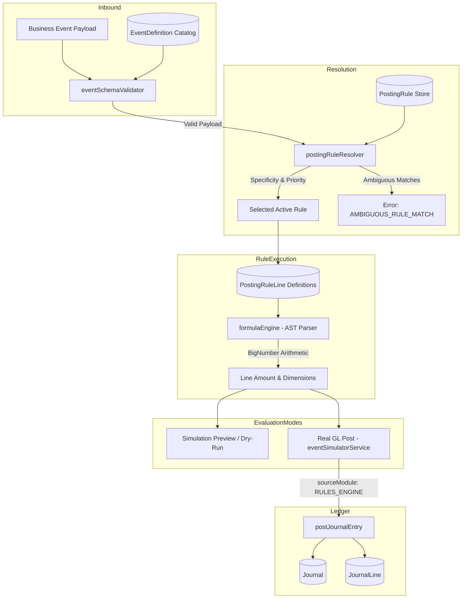
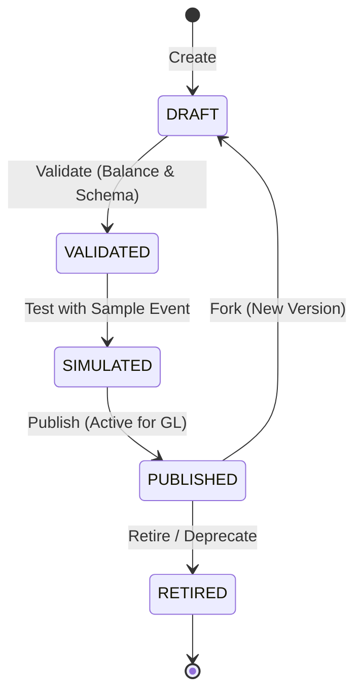

# Veridex One — Dynamic Journal Entry Rule Engine Architecture & Design

**Version:** 4.6.0-R2  
**Module:** Rules Engine & Accounting Simulation  
**Status:** Implemented & Verified (Phase R2)  

---

## 1. Executive Overview

The **Dynamic Journal Entry Rule Engine** transitions Veridex One from hardcoded journal entry creation to an event-driven, tenant-configurable accounting platform. Tenant administrators and authorized finance controllers can authoritatively define:

1. **Event Contracts (`EventDefinition`)**: Strongly typed JSON Schema (Draft-07) specifications governing inbound business events.
2. **Posting Rules (`PostingRule` & `PostingRuleLine`)**: Configurable mapping definitions that translate event payloads into balanced double-entry General Ledger journals.
3. **Safe Formula Calculations (`formulaEngine`)**: An AST-based arithmetic parser ensuring zero arbitrary code execution while providing exact decimal precision via `bignumber.js`.
4. **Deterministic Rule Resolution (`postingRuleResolver`)**: Explicit specificity and priority scoring with strict ambiguity detection (`AMBIGUOUS_RULE_MATCH`).
5. **Rule Lifecycle Management**: Safe promotion workflow (`DRAFT` → `VALIDATED` → `SIMULATED` → `PUBLISHED` → `RETIRED`) with immutable versioning and forking.
6. **Rule Test Cases (`PostingRuleTestCase`)**: Tenant-scoped test fixtures for CI/CD and pre-publication verification.
7. **Simulation & Posting Boundary (`eventSimulatorService`)**: Zero-side-effect simulation alongside idempotent General Ledger posting into the persistent double-entry GL ledger.

---

## 2. Architecture & Component Diagram



---

## 3. Safe Formula Engine (`formulaEngine.js`)

Financial formula evaluation in a multi-tenant SaaS requires complete isolation from runtime execution environments to eliminate code-injection risks (e.g., `eval`, `Function`, prototype pollution).

### 3.1 Tokenizer & Recursive-Descent AST Parser
The formula engine does not use JavaScript's `eval()` or runtime compilers. Instead, it tokenizes mathematical expressions into standard lexical tokens:
- **Literals**: Numbers (`150`, `37650.00`) and Strings (`'USD'`).
- **Identifiers**: Property paths into the event payload (e.g., `payload.premium.written`, `payload.taxes.state_surplus`).
- **Operators**: `+`, `-`, `*`, `/`, `%`.
- **Parentheses**: `(`, `)`.

The parser constructs an Abstract Syntax Tree (AST) using standard recursive-descent grammar:
$$\text{Expression} \rightarrow \text{Term} \; (('+' \mid '-') \; \text{Term})^*$$
$$\text{Term} \rightarrow \text{Factor} \; (('*' \mid '/' \mid '\%') \; \text{Factor})^*$$
$$\text{Factor} \rightarrow \text{Unary} \mid \text{Primary}$$

### 3.2 Security Sandbox & Identifier Whitelisting
- **Forbidden Identifiers**: Any token matching `process`, `global`, `window`, `document`, `eval`, `require`, `Function`, `constructor`, `__proto__`, or `prototype` throws a `SECURITY_VIOLATION` syntax error before evaluation.
- **Payload Path Resolution**: Identifiers are resolved strictly against the supplied event payload dictionary using safe dot-path lookup (`lodash.get` equivalent). Non-numeric results in arithmetic contexts are safely handled or rejected.

### 3.3 Decimal Precision via `bignumber.js`
All numerical evaluations are executed with arbitrary precision `BigNumber`:
- Addition: `a.plus(b)`
- Subtraction: `a.minus(b)`
- Multiplication: `a.times(b)`
- Division: `a.dividedBy(b)` (with division-by-zero validation raising an error)
- Rounding: Configurable rounding modes per rule line (`HALF_UP`, `ROUND_UP`, `ROUND_DOWN`), formatted strictly to 2 decimal places (`toFixed(2)`).

---

## 4. Deterministic Rule Resolver (`postingRuleResolver.js`)

When an event is received, multiple posting rules might exist in the tenant's registry. The resolver executes deterministic rule selection:

### 4.1 Candidate Filtering
Rules are evaluated if and only if:
1. `tenant_id` matches the event tenant.
2. `event_type` matches the incoming event.
3. `status === 'PUBLISHED'`.
4. `effective_from <= event_date` and (`effective_to === null` or `effective_to >= event_date`).

### 4.2 Condition Evaluation
Rules define an array of `conditions` evaluated against the event payload:
- `field`: Payload dot-path (e.g., `payload.line_of_business`).
- `operator`: Supported operators:
  - `eq`: Exact equality (`===`).
  - `neq`: Not equal (`!==`).
  - `gt`, `gte`: Numeric greater than / greater than or equal.
  - `lt`, `lte`: Numeric less than / less than or equal.
  - `in`: Array membership.
  - `not_in`: Array non-membership.
  - `exists`: Field presence check (`true` or `false`).
- `value`: Target value for comparison.

All conditions in a rule must evaluate to `true` (logical `AND`).

### 4.3 Specificity & Priority Scoring
Candidate rules that satisfy all conditions are scored by:
1. **Specificity (`score`)**: Total count of evaluated conditions matching the event payload. Rules with more explicit condition matches take precedence over catch-all rules.
2. **Priority (`rule.priority`)**: Integer value where lower numbers indicate higher preference (default: `100`).
3. **Recency**: Tie-break using `updated_at` (latest wins).

### 4.4 Ambiguity Detection
If two or more published candidate rules share the **exact same specificity score** and the **exact same priority**, the resolver aborts with an `AMBIGUOUS_RULE_MATCH` error:
```json
{
  "code": "AMBIGUOUS_RULE_MATCH",
  "message": "Multiple rules matched with identical specificity (1) and priority (10): PR-COMM-001, PR-COMM-002",
  "candidate_rule_codes": ["PR-COMM-001", "PR-COMM-002"]
}
```
This prevents non-deterministic financial journal creation.

---

## 5. Posting Rule Lifecycle & Versioning

Posting rules control actual financial ledger writes and adhere to an immutable promotion lifecycle:



### 5.1 Lifecycle Transitions
- **`DRAFT`**: Authoring state. Rules can be updated, lines added/removed/edited. Cannot be matched by runtime events.
- **`VALIDATED`**: The rule definition, expression syntax, and chart of accounts mapping have been validated.
- **`SIMULATED`**: The rule has successfully generated a balanced journal in simulation mode against a test fixture.
- **`PUBLISHED`**: Active rule available for runtime resolution and posting. Only one version of a rule code can be `PUBLISHED` at any given time.
- **`RETIRED`**: Archived rule. Preserved for auditability, never matched by the resolver.

### 5.2 Versioning & Forking
- Rules are identified by `{ tenant_id, rule_code, version }`.
- When an existing `PUBLISHED` rule requires modification:
  1. The user invokes the `fork` action (`POST /api/v1/rules/:id/fork`).
  2. The system clones the rule and all its lines into a new record with `version = current_version + 1` and `status = 'DRAFT'`.
  3. The original version remains `PUBLISHED` until the new version is promoted to `PUBLISHED`, at which point the previous version is automatically retired or superseded.

---

## 6. Simulation & Real GL Posting Boundary

### 6.1 Dry-Run Simulation (`simulateJournalFromEvent`)
- Reads the event payload and resolves the matching published rule.
- Evaluates each `PostingRuleLine` formula expression and dimension mappings.
- Computes debits and credits.
- Verifies $\sum \text{Debits} == \sum \text{Credits}$.
- Generates a preview response with zero database writes:
  ```json
  {
    "simulated": true,
    "balanced": true,
    "rule_code": "PR-POL-001",
    "rule_version": 1,
    "total_debit": 37650.00,
    "total_credit": 37650.00,
    "lines": [...]
  }
  ```

### 6.2 Real GL Posting (`postJournalFromResolvedRule`)
- Resolves the rule and constructs journal lines identically to simulation.
- Dispatches the journal to the core General Ledger posting service: `postJournalEntry()`.
- Sets `sourceModule: 'RULES_ENGINE'`, ensuring:
  - Idempotent duplicate check based on `reference_number` (composite: `event_id` or `idempotency_key`).
  - Period lock validation.
  - Double-entry balance enforcement at the database level.
  - Creation of immutable `Journal` and `JournalLine` records.

---

## 7. Rule Test Cases & Configuration Bundles

### 7.1 Test Cases (`PostingRuleTestCase`)
Tenant administrators can register automated test cases containing:
- `event_definition_id` / `event_type`
- Input test payload fixture
- Expected rule code and version
- Expected balanced journal lines (account codes, directions, amounts, dimensions)
Executing test cases verifies system integrity without creating GL journal side effects.

### 7.2 Configuration Bundles (`/api/v1/config-bundle`)
Facilitates migration, tenant cloning, and disaster recovery:
- **Export**: Exports a JSON bundle containing all Event Definitions, Posting Rules, and Rule Lines for a tenant.
- **Import Preview**: Compares the bundle against the target tenant, detailing rules to create, update, or skip.
- **Import Apply**: Atomically or sequentially upserts the configuration bundle into the target tenant.
