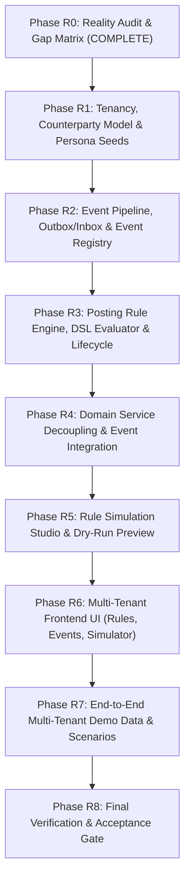

# Veridex One — Rules-Driven Gap Matrix & Implementation Roadmap
**Document ID:** `RULES_DRIVEN_GAP_MATRIX.md`  
**Phase:** R0 Reality Audit  
**Date:** October 13, 2026  
**Status:** COMPLETE & APPROVED FOR REVIEW  

---

## 1. Capability Gap Matrix

This matrix maps every architectural capability required by the Rules-Driven Multi-Tenant Insurance Finance SaaS specification against the current reality of the codebase.

| Domain Area | Required Capability | Current Reality in Codebase | Classification | Target Phase |
| :--- | :--- | :--- | :---: | :---: |
| **Tenancy & Counterparties** | Multi-tenant type taxonomy (`CARRIER`, `MGA`, `BROKER`, `OTHER`) | `Tenant.js` only has status `ACTIVE`, `SUSPENDED`, `ONBOARDING`. No tenant type. | **NEEDS REFACTOR** | **R1** |
| **Tenancy & Counterparties** | Unified Counterparty / Party Model (`Party`, `PartyRole`, `Contact`) | Customers and carriers exist only as string names or fragmented references across tables. | **BUILD NEW** | **R1** |
| **Tenancy & Counterparties** | Seed fixtures for 3 distinct tenant personas (`TENANT_SUMMIT` [Carrier], `TENANT_HARBOR` [MGA], `TENANT_BRIGHTLINE` [Broker]) | Only ad-hoc test tenants created dynamically during tests or single seed. | **BUILD NEW** | **R1** |
| **Event Pipeline** | Durable Outbox Pattern (`OutboxEvent`) for transaction events | Zero Outbox implementation. Domain mutations invoke journals synchronously. | **BUILD NEW** | **R2** |
| **Event Pipeline** | Idempotent Inbox Consumer (`InboxEvent`) with deduplication | Zero Inbox implementation. Duplicate protection exists only at Journal referenceId level. | **BUILD NEW** | **R2** |
| **Event Pipeline** | Standardized Insurance Event Schema Registry | Event payloads are ad-hoc JavaScript objects constructed inline in service methods. | **BUILD NEW** | **R2** |
| **Posting Rule Engine** | Rule Precedence Hierarchy (Tenant Specific $\rightarrow$ Tenant Type Template $\rightarrow$ Platform Default) | Basic `PostingRule` schema has only `tenant_id` and `rule_code`. No precedence resolver. | **BUILD NEW** | **R3** |
| **Posting Rule Engine** | Dynamic Matching Criteria (Match on `event_type`, `lob`, `state`, `entity_type`, `payment_method`) | No matching criteria fields in `PostingRule`. | **NEEDS REFACTOR** | **R3** |
| **Posting Rule Engine** | Rule Governance Lifecycle (`DRAFT`, `VALIDATED`, `PUBLISHED`, `RETIRED`) | Only simple boolean-like status `ACTIVE` / `INACTIVE`. No immutable version history. | **NEEDS REFACTOR** | **R3** |
| **Posting Rule Engine** | Safe Mathematical Expression DSL for `PostingRuleLine` | `amount_field` is a static string property name. No support for math expressions, percentages, or conditional logic. | **BUILD NEW** | **R3** |
| **Posting Rule Engine** | Dynamic Chart of Accounts Mapping & Validation | Hardcoded account strings (`'1100'`, `'1010'`, `'2200'`, `'4000'`, etc.) throughout all domain services. | **NEEDS REFACTOR** | **R3** |
| **Domain Services** | Billing & AR Event-Driven Journal Generation | `billingService.js` directly hardcodes debit and credit lines for invoices and payments. | **NEEDS REFACTOR** | **R4** |
| **Domain Services** | Commissions & Fiduciary Event-Driven Journal Generation | `commissionsService.js` directly hardcodes trust sweep and carrier settlement lines. | **NEEDS REFACTOR** | **R4** |
| **Domain Services** | Treasury & Bank Rec Event-Driven Journal Generation | `treasuryService.js` directly hardcodes NSF return and refund lines. | **NEEDS REFACTOR** | **R4** |
| **Domain Services** | Finance Close & UPR Event-Driven Journal Generation | `financeCloseService.js` directly hardcodes UPR amortization lines. | **NEEDS REFACTOR** | **R4** |
| **Simulation Studio** | Interactive Rule Simulator & Dry-Run JE Preview | No simulator exists. Any posting test must write persistent records to database. | **BUILD NEW** | **R5** |
| **Simulation Studio** | Divergent Accounting Simulation (Compare Carrier vs MGA vs Broker on same event) | Non-existent. | **BUILD NEW** | **R5** |
| **Frontend UI** | Posting Rule Builder & Formula DSL Editor | Basic static tables for listing GL accounts. No rule editor or condition builder. | **BUILD NEW** | **R6** |
| **Frontend UI** | Event Stream & Outbox/Inbox Monitor | Non-existent in frontend. | **BUILD NEW** | **R6** |
| **Frontend UI** | Accounting Simulator UI (Payload editor $\rightarrow$ Evaluated lines $\rightarrow$ Balance impact preview) | Non-existent in frontend. | **BUILD NEW** | **R6** |
| **Demo Data** | Realistic Multi-Tenant Test Data Pack | Isolated single-scenario fixtures without multi-tenant counterparty transactions. | **BUILD NEW** | **R7** |
| **Quality Gate** | Cross-Module Multi-Tenant Automated Regression Gate | Existing 105 tests pass against hardcoded services; new tests must verify dynamic rule evaluation. | **BUILD NEW** | **R8** |

---

## 2. Refactoring vs. Greenfield Boundaries

To preserve existing investments while ensuring architectural integrity:

### What Is PRESERVED (Unchanged or Extended)
- **All 47 Existing Finance Domain Models:** Modules 12, 13, 14, 40, and 41 models remain the core database schema.
- **Core GL Invariants in [`journalPostingService.js`](file:///c:/Users/AkhileshSoni/Desktop/veridexoneDoc/veridex_accoouunting_finance/backend/src/services/journalPostingService.js):** Double-entry balance check ($\sum Dr = \sum Cr$), closed-period locks, account existence and active checks, atomic balance updates.
- **Decimal128 / BigNumber Arithmetic:** Exact rounding and monetary safety remain enforced across all calculations.
- **Tenant Context Middleware:** Scoping by `tenant_id` remains strictly enforced on all queries and mutations.

### What Is REFACTORED
- **[`Tenant.js`](file:///c:/Users/AkhileshSoni/Desktop/veridexoneDoc/veridex_accoouunting_finance/backend/src/models/Tenant.js):** Add `tenant_type` (`CARRIER`, `MGA`, `BROKER`, `OTHER`), parent tenant support, and feature configuration flags.
- **[`PostingRule.js`](file:///c:/Users/AkhileshSoni/Desktop/veridexoneDoc/veridex_accoouunting_finance/backend/src/models/PostingRule.js):** Add `version`, `lifecycle_status` (`DRAFT`, `VALIDATED`, `PUBLISHED`, `RETIRED`), `precedence`, `tenant_type_default`, `matching_criteria` (JSON criteria schema).
- **[`PostingRuleLine.js`](file:///c:/Users/AkhileshSoni/Desktop/veridexoneDoc/veridex_accoouunting_finance/backend/src/models/PostingRuleLine.js):** Add formula expression support, condition predicates, dimension mappings, and dynamic account resolution tokens.
- **Domain Services (`billingService`, `commissionsService`, `treasuryService`, `financeCloseService`):** Replace inline `journalLines = [...]` blocks with calls to an event dispatching and rule resolution layer (`ruleResolverService.js`).

### What Is BUILT NEW
- **Models:**
  - `Party.js`, `PartyRole.js` (Counterparty directory for carriers, MGAs, brokers, policyholders).
  - `OutboxEvent.js` (Durable event outbox).
  - `InboxEvent.js` (Durable idempotent event inbox).
  - `PostingRuleVersion.js` (Immutable historical snapshot of published rules).
- **Services:**
  - `ruleResolverService.js`: Matches incoming event payloads against rules using precedence and criteria.
  - `expressionEvaluator.js`: Safe, sandboxed arithmetic and formula parser supporting BigNumber operations.
  - `eventDispatcherService.js`: Emits events, processes outbox/inbox records, and orchestrates journal postings.
  - `simulationService.js`: Dry-run journal generator and balance projection without persisting database modifications.
- **Controllers & APIs:**
  - `/api/v1/rules/*`: Rule lifecycle management, versioning, publishing, and formula testing.
  - `/api/v1/simulator/*`: Dry-run simulation and divergent tenant accounting comparison.
  - `/api/v1/events/*`: Event emission, inspection, and replay.
- **Frontend Components:**
  - `RuleBuilderView.jsx`: Interactive visual rule designer with line expression builder.
  - `AccountingSimulatorView.jsx`: Interactive sandbox to fire events and inspect preview journals and balance impacts.
  - `EventLogView.jsx`: Live audit stream of business events, outbox status, and linked journals.

---

## 3. Phased Implementation Roadmap (R1 to R8)

### Phase Details

#### Phase R1: Tenancy, Counterparty Models & Persona Seeds
- Update `Tenant` model with `tenant_type` (`CARRIER`, `MGA`, `BROKER`, `OTHER`).
- Implement `Party` and `PartyRole` models.
- Seed the 3 canonical persona tenants:
  - **Summit National Insurance Co.** (`TENANT_SUMMIT`, `CARRIER`)
  - **Harbor Risk Underwriting Managers** (`TENANT_HARBOR`, `MGA`)
  - **Brightline Commercial Insurance Services** (`TENANT_BRIGHTLINE`, `BROKER`)
- Seed default COA templates appropriate for each tenant type.

#### Phase R2: Durable Event Pipeline & Event Registry
- Create `OutboxEvent` and `InboxEvent` models.
- Build `eventDispatcherService.js` with transaction-safe outbox writes, idempotency checking, and retry capability.
- Register canonical insurance finance event types:
  - `POLICY_BOUND`, `INVOICE_ISSUED`, `PAYMENT_RECEIVED`, `COMMISSION_EARNED`, `TRUST_SWEEP_REQUESTED`, `SETTLEMENT_DISBURSED`, `UPR_AMORTIZATION_TRIGGERED`, `PAYMENT_RETURNED`, `REFUND_DISBURSED`.

#### Phase R3: Posting Rule Engine & Expression Evaluator
- Refactor `PostingRule` and `PostingRuleLine` models with lifecycle states and criteria matching.
- Create `expressionEvaluator.js` supporting BigNumber math (e.g. `event.premium * 0.15`).
- Implement `ruleResolverService.js` with 3-tier precedence:
  1. Specific Tenant Rule (active and published)
  2. Tenant Type Template Rule (`CARRIER`, `MGA`, `BROKER`)
  3. Platform Default Fallback Rule

#### Phase R4: Domain Services Refactoring & Event Integration
- Refactor `billingService`, `commissionsService`, `treasuryService`, and `financeCloseService`.
- Replace hardcoded journal generation with event dispatching to `ruleResolverService`.
- Ensure fallback compatibility so existing operational tests pass uninterrupted.

#### Phase R5: Rule Simulation Studio & Dry-Run Engine
- Build `simulationService.js` capable of dry-running any event payload against tenant rules.
- Return generated journal lines, balance impact delta, and rule trace without committing to the database.
- Support side-by-side divergent simulation (Carrier vs MGA vs Broker on the same business event).

#### Phase R6: Multi-Tenant Frontend UI
- Add Rule Studio tab to Frontend navigation.
- Build interactive visual Rule Builder with formula editor.
- Build Event Log viewer with drill-down into linked journals.
- Build interactive Accounting Simulator screen.

#### Phase R7: End-to-End Demo Datasets & Divergent Scenarios
- Seed full realistic scenario data across Summit (Carrier), Harbor (MGA), and Brightline (Broker).
- Demonstrate divergent accounting behavior for the same underlying insurance contract:
  - Carrier: Gross written premium, unearned premium reserve liability, carrier commission expense.
  - MGA: Fiduciary trust cash, agency commission revenue, net remittance payable to carrier.
  - Broker: Net receivable from client, brokerage commission revenue, premium payable to MGA/Carrier.

#### Phase R8: Comprehensive Test Suite & Acceptance Report
- Full test suite covering rule resolution, expression evaluation, multi-tenant divergence, simulator, and domain service regressions.
- Generate `docs/RULES_DRIVEN_COMPLETION_REPORT.md` with complete evidence.
