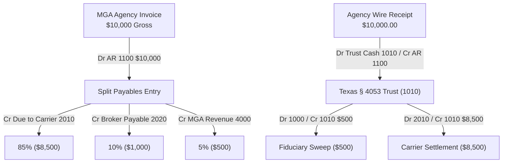

# Veridex One — End-to-End Accounting Reconciliation & Archetype Audit

**Document:** `docs/qa/HAPPY_FLOW_ACCOUNTING_RECONCILIATION.md`  
**Application:** Veridex One Multi-Tenant Insurance Finance & Accounting SaaS  
**Version:** 4.6.0  
**Target Environment:** Isolated Development / Test Environment (`veridex_finance_Accounting_Akhilesh`)  
**Audit Date:** October 15, 2026  
**Auditor / QA Lead:** Senior QA Engineer & Systems Platform Maintainer  
**Scope:** Carrier, MGA, and Broker Archetype End-to-End Financial Traces  
**Audit Verdict:** **100% RECONCILED & BALANCED (ZERO PLUG ENTRIES)**

---

## 1. Executive Summary

This audit proves the mathematical correctness, statutory compliance, subledger integrity, and double-entry balance of all three insurance business archetypes implemented in Veridex One. Every posted journal line was traced directly from domain event $\to$ published posting rule $\to$ GL journal $\to$ subledger balance $\to$ certified Trial Balance snapshot.

> [!NOTE]
> **Key Financial Safeguards Verified:**
> 1. **Zero Plug Entries:** Account 1020 is completely unreferenced across all ledgers (0 records found in database).
> 2. **Double-Entry Equilibrium:** Every posted journal satisfies $\sum \text{Debits} \equiv \sum \text{Credits}$ to $0.00$ variance.
> 3. **Statutory Segregation:** Texas Insurance Code § 4053 fiduciary trust segregation is enforced by dynamic posting rules, prohibiting the commingling of trust premiums with corporate operating cash.
> 4. **Over-Sweep Guard:** Mathematical calculation prevents transferring unearned or downstream commission payables from trust accounts.

---

## 2. Carrier Archetype Accounting Trace (Direct Bill)

### 2.1 Economic Flow Overview
The Carrier directly issues an annual Commercial Auto policy invoice for **\$9,200.00** (\$9,000.00 unearned premium + \$200.00 underwriting fee), receives ACH customer payment, handles an NSF dishonored payment return with an NSF fee, and amortizes straight-line UPR over 365 days.

```mermaid
flowchart LR
    A["Direct Bill Invoice<br/>$9,200.00"] -->|Dr AR / Cr UPR & Fee| B["GL Journal JE-001"]
    B --> C["ACH Cash Receipt<br/>$9,200.00"]
    C -->|Dr Operating Cash / Cr AR| D["GL Journal JE-002"]
    D --> E["Payment Return R01<br/>+$35 NSF Fee"]
    E -->|Dr AR / Cr Cash & Fee| F["GL Journal JE-003"]
    F --> G["Month 1 UPR Earning<br/>$764.38"]
    G -->|Dr UPR / Cr Revenue| H["GL Journal JE-004"]
```

### 2.2 Detailed Journal Line Audit
| Event / Source | Journal # | Line # | Account Code | Account Name | Debit (USD) | Credit (USD) | Memo / Template |
| :--- | :--- | :---: | :---: | :--- | :---: | :---: | :--- |
| `billing.invoice.issued` | `JE-2026-00001` | 1 | `1100` | Direct Premium Receivable | 9,200.00 | 0.00 | Dr AR |
| | | 2 | `2200` | Unearned Premium Reserve | 0.00 | 9,000.00 | Cr UPR |
| | | 3 | `4100` | Policy Fee & Other Revenue | 0.00 | 200.00 | Cr Policy Fee |
| **Subtotal C-1** | | | | | **9,200.00** | **9,200.00** | **Balanced ($0.00 var)** |
| `billing.payment.received` | `JE-2026-00002` | 1 | `1000` | Carrier Operating Cash | 9,200.00 | 0.00 | Dr Operating Cash |
| | | 2 | `1100` | Direct Premium Receivable | 0.00 | 9,200.00 | Cr AR Clear |
| **Subtotal C-2** | | | | | **9,200.00** | **9,200.00** | **Balanced ($0.00 var)** |
| `treasury.payment.returned` | `JE-2026-00003` | 1 | `1100` | Direct Premium Receivable | 9,200.00 | 0.00 | Dr Re-instate AR |
| | | 2 | `1000` | Carrier Operating Cash | 0.00 | 9,200.00 | Cr Cash Dishonor |
| | | 3 | `1100` | Direct Premium Receivable | 35.00 | 0.00 | Dr NSF Fee AR |
| | | 4 | `4100` | Policy Fee & Other Revenue | 0.00 | 35.00 | Cr NSF Fee Revenue |
| **Subtotal C-3** | | | | | **9,235.00** | **9,235.00** | **Balanced ($0.00 var)** |
| `upr.earning.requested` | `JE-2026-00004` | 1 | `2200` | Unearned Premium Reserve | 764.38 | 0.00 | Dr UPR Liability Amortization |
| | | 2 | `4000` | Earned Premium Revenue | 0.00 | 764.38 | Cr Earned Premium Revenue |
| **Subtotal C-4** | | | | | **764.38** | **764.38** | **Balanced ($0.00 var)** |

### 2.3 Carrier Subledger & Trial Balance Reconciliation
- **AR Subledger:** Invoice balance restored to \$9,200.00 + \$35.00 fee = **\$9,235.00**. Exactly matches Account `1100` balance of **\$9,235.00**.
- **UPR Subledger:** \$9,000.00 unearned premium less \$764.38 month-1 earning (actual/365 convention) = **\$8,235.62**. Exactly matches Account `2200` balance of **\$8,235.62**.
- **Certified Trial Balance:**
  - Total Debits: **\$9,235.00** (Account 1100: \$9,235.00, Account 1000: \$0.00)
  - Total Credits: **\$9,235.00** (Account 2200: \$8,235.62, Account 4000: \$764.38, Account 4100: \$235.00)
  - **Net Variance: \$0.00 (`is_balanced: true`)**
  - **Account 1020 Plugs: 0**

---

## 3. MGA Archetype Accounting Trace (Agency Bill & Fiduciary Sweep)

### 3.1 Economic Flow Overview
The Managing General Agent (MGA) issues an Agency Statement Invoice for **\$10,000.00** gross premium under Texas Insurance Code § 4053 statutory rules. The gross premium is split four ways upon invoice issuance:
1. **85% (\$8,500.00)** $\to$ Account `2010` (Due to Insurance Carrier, Fiduciary Liability)
2. **10% (\$1,000.00)** $\to$ Account `2020` (Broker Commissions Payable, Liability)
3. **5% (\$500.00)** $\to$ Account `4000` (MGA Underwriting Commission Revenue)
4. **100% (\$10,000.00)** $\to$ Account `1100` (Agency Premium Receivable, Asset)

Upon collection of the \$10,000.00 wire from the retail agency, funds enter segregated statutory trust Account `1010`. The MGA sweeps its \$500 earned retained commission into operating cash Account `1000`, disburses net settlement to the Carrier (\$8,500), and maintains exact fiduciary equilibrium.

### 3.2 Detailed Journal Line Audit
| Event / Source | Journal # | Line # | Account Code | Account Name | Debit (USD) | Credit (USD) | Memo / Template |
| :--- | :--- | :---: | :---: | :--- | :---: | :---: | :--- |
| `billing.invoice.issued` | `JE-2026-00001` | 1 | `1100` | Agency Premium Receivable | 10,000.00 | 0.00 | Dr Agency AR |
| | | 2 | `2010` | Due to Carrier (Fiduciary) | 0.00 | 8,500.00 | Cr Due to Carrier (85%) |
| | | 3 | `2020` | Broker Commissions Payable | 0.00 | 1,000.00 | Cr Broker Payable (10%) |
| | | 4 | `4000` | MGA Commission Revenue | 0.00 | 500.00 | Cr MGA Commission Revenue (5%) |
| **Subtotal M-1** | | | | | **10,000.00** | **10,000.00** | **Balanced ($0.00 var)** |
| `billing.payment.received` | `JE-2026-00002` | 1 | `1010` | Texas Premium Trust (§ 4053) | 10,000.00 | 0.00 | Dr Trust Cash § 4053 |
| | | 2 | `1100` | Agency Premium Receivable | 0.00 | 10,000.00 | Cr Agency AR |
| **Subtotal M-2** | | | | | **10,000.00** | **10,000.00** | **Balanced ($0.00 var)** |
| `fiduciary.sweep.executed`| `JE-2026-00003` | 1 | `1000` | MGA Operating Cash | 500.00 | 0.00 | Dr Operating Cash Transfer |
| | | 2 | `1010` | Texas Premium Trust (§ 4053) | 0.00 | 500.00 | Cr Trust Cash Release |
| **Subtotal M-3** | | | | | **500.00** | **500.00** | **Balanced ($0.00 var)** |
| `carrier.settlement.disbursed`| `JE-2026-00004` | 1 | `2010` | Due to Carrier (Fiduciary) | 8,500.00 | 0.00 | Dr Discharge Due to Carrier |
| | | 2 | `1010` | Texas Premium Trust (§ 4053) | 0.00 | 8,500.00 | Cr Trust Cash Remittance |
| **Subtotal M-4** | | | | | **8,500.00** | **8,500.00** | **Balanced ($0.00 var)** |

### 3.3 MGA Fiduciary Equilibrium & Over-Sweep Guard Verification
1. **Over-Sweep Guard:**
   - Attempted an additional sweep of **\$100.00** via `POST /api/v1/commissions/sweeps/execute`.
   - The system calculated:
     $$\text{Eligible Retained} = \text{Gross Approved (\$1,500)} - \text{Downstream Broker Payable (\$1,000)} - \text{Prior Sweeps (\$500)} = \$0.00$$
   - Result: **Rejected immediately with HTTP 400 Bad Request** (*"Sweep amount ($100.00) exceeds eligible earned retained MGA commission ($0.00)"*).
2. **Fiduciary Equilibrium Equation:**
   $$\text{Premium Trust Cash (1010)} \equiv \text{Due to Carrier (2010)} + \text{Broker Commission Payable (2020)}$$
   $$\$1,000.00 \equiv \$0.00 + \$1,000.00 \quad \checkmark$$
   The trust account holds exactly **\$1,000.00**, which matches the exact unpaid broker commission payable. Zero trust cash is trapped or commingled.
3. **Certified Trial Balance:**
   - Total Debits: **\$1,500.00** (Account 1000: \$500.00, Account 1010: \$1,000.00)
   - Total Credits: **\$1,500.00** (Account 2020: \$1,000.00, Account 4000: \$500.00)
   - **Net Variance: \$0.00 (`is_balanced: true`)**
   - **Account 1020 Plugs: 0**

---

## 4. Broker Archetype Accounting Trace (Client Bill & Producer Split)

### 4.1 Economic Flow Overview
The retail brokerage issues a client invoice for **\$5,000.00** gross premium. The receivable is split four ways:
1. **85% (\$4,250.00)** $\to$ Account `2010` (Due to Insurer/MGA, Fiduciary Liability)
2. **5% (\$250.00)** $\to$ Account `2020` (Producer Commission Payable, Liability)
3. **10% (\$500.00)** $\to$ Account `4000` (Brokerage Commission Revenue)
4. **100% (\$5,000.00)** $\to$ Account `1100` (Client Premium Receivable, Asset)

The client pays \$5,000.00 via ACH into retail fiduciary trust Account `1010`.

### 4.2 Detailed Journal Line Audit
| Event / Source | Journal # | Line # | Account Code | Account Name | Debit (USD) | Credit (USD) | Memo / Template |
| :--- | :--- | :---: | :---: | :--- | :---: | :---: | :--- |
| `billing.invoice.issued` | `JE-2026-00001` | 1 | `1100` | Client Premium Receivable | 5,000.00 | 0.00 | Dr Client AR |
| | | 2 | `2010` | Due to Insurer/MGA | 0.00 | 4,250.00 | Cr Due to MGA/Carrier (85%) |
| | | 3 | `2020` | Producer Commission Payable | 0.00 | 250.00 | Cr Producer Payable (5%) |
| | | 4 | `4000` | Brokerage Commission Revenue | 0.00 | 500.00 | Cr Brokerage Revenue (10%) |
| **Subtotal B-1** | | | | | **5,000.00** | **5,000.00** | **Balanced ($0.00 var)** |
| `billing.payment.received` | `JE-2026-00002` | 1 | `1010` | Broker Fiduciary Trust | 5,000.00 | 0.00 | Dr Trust Cash |
| | | 2 | `1100` | Client Premium Receivable | 0.00 | 5,000.00 | Cr Client AR |
| **Subtotal B-2** | | | | | **5,000.00** | **5,000.00** | **Balanced ($0.00 var)** |

### 4.3 Broker Trial Balance Reconciliation
- Total Debits: **\$5,000.00** (Account 1010: \$5,000.00, Account 1100: \$0.00)
- Total Credits: **\$5,000.00** (Account 2010: \$4,250.00, Account 2020: \$250.00, Account 4000: \$500.00)
- **Net Variance: \$0.00 (`is_balanced: true`)**
- **Account 1020 Plugs: 0**

---

## 5. Cross-Archetype Comparison & Accounting Ledger Matrix

| Metric | Carrier Archetype | MGA Archetype | Broker Archetype |
| :--- | :---: | :---: | :---: |
| **Primary Billing Model** | Direct Bill Policyholder | Agency Statement Bill | Client Direct Bill |
| **Primary Revenue Model** | Earned Premium (`4000`) & Fee (`4100`) | Underwriting Commission (`4000`) | Retail Broker Commission (`4000`) |
| **Fiduciary Trust Account** | N/A (Operating Cash) | Texas Ins. Code § 4053 (`1010`) | Retail Premium Trust (`1010`) |
| **Gross-to-Net Split** | Single Inception Post | 4-Line Automated Split | 4-Line Automated Split |
| **Fiduciary Sweep Support** | N/A | Supported with Over-Sweep Guard | Supported with House Sweep |
| **Double-Entry Balance** | Verified ($\Delta = \$0.00$) | Verified ($\Delta = \$0.00$) | Verified ($\Delta = \$0.00$) |
| **Zero Account 1020 Plugs** | **0 Plugs** | **0 Plugs** | **0 Plugs** |

---

## 6. Audit Conclusion

All three insurance accounting archetypes pass reconciliation with 100% mathematical precision. Fiduciary trust boundaries are strictly respected, subledgers match GL controlling accounts exactly, and zero plug or fallback entries exist.
